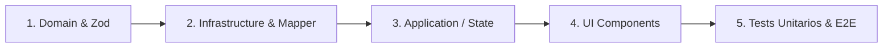

# Guía Paso a Paso para Agregar Nuevas Características (.agent/skills)

Cuando un desarrollador o agente de IA agregue una nueva característica o endpoint a **MyNutritor-UI**, debe seguir obligatoriamente este flujo de 5 pasos:

## Paso 1: Definir Contrato Zod y Entidad en `domain`

1. Crear la entidad pura en `src/lib/domain/<feature>/<Entity>.ts`.
2. Definir la interfaz del repositorio en `src/lib/domain/<feature>/I<Feature>Repository.ts`.
3. Nunca importar Svelte, localStorage o HttpClient dentro de `src/lib/domain/`.

## Paso 2: Implementar Repositorio y Mapper en `infrastructure`

1. Definir los esquemas Zod en `src/lib/infrastructure/dtos/<feature>.dto.ts`.
2. Crear la clase o funciones mapper en `src/lib/infrastructure/mappers/<Feature>Mapper.ts`:
   - Validar la respuesta con `schema.parse(data)`.
   - Convertir snake_case o representaciones primitivas a la entidad de dominio camelCase.
3. Crear el repositorio en `src/lib/infrastructure/repositories/<Feature>Repository.ts` implementando la interfaz `I<Feature>Repository`. Inyectar `IHttpClient`.

## Paso 3: Crear Caso de Uso y Gestión de Estado en `application`

1. Crear el store o módulo reactivo en `src/lib/application/<feature>/<feature>.store.ts`.
2. Exponer únicamente los métodos necesarios para la UI (ej. `fetchItems()`, `createItem()`, `deleteItem()`).
3. Manejar estados de carga (`loading`), errores legibles (`error`) y datos actualizados (`data`).

## Paso 4: Construir Componentes en `ui`

1. Si se requieren piezas atómicas (botones, inputs, badges), crearlas en `src/lib/ui/components/`.
2. Implementar los componentes funcionales en `src/lib/ui/features/<feature>/`.
3. Conectar la UI al store de `application`. Prohibido llamar a repositorios o `fetch` desde componentes presentacionales.

## Paso 5: Escribir Pruebas

1. Escribir pruebas unitarias del mapper en `src/lib/infrastructure/mappers/<Feature>Mapper.test.ts`.
2. Escribir pruebas unitarias del repositorio con `IHttpClient` mockeado.
3. Si la característica es un flujo crítico (ej. Auth, Checkout, Creación), agregar o actualizar test de Playwright en `e2e/`.
4. Ejecutar `npm run test` y `npm run check`.
